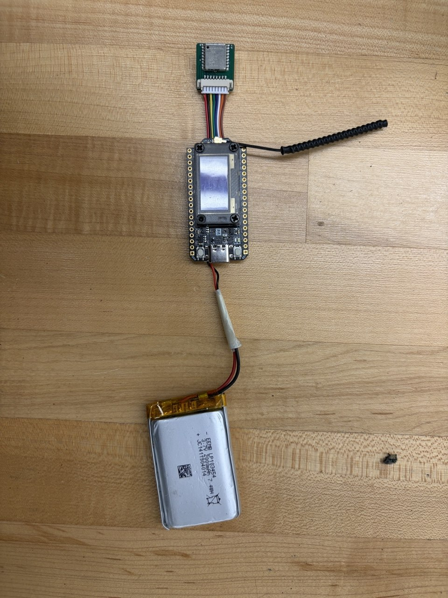
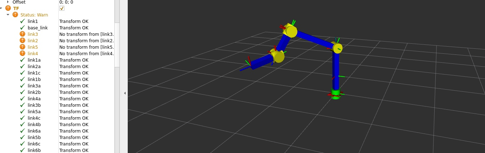
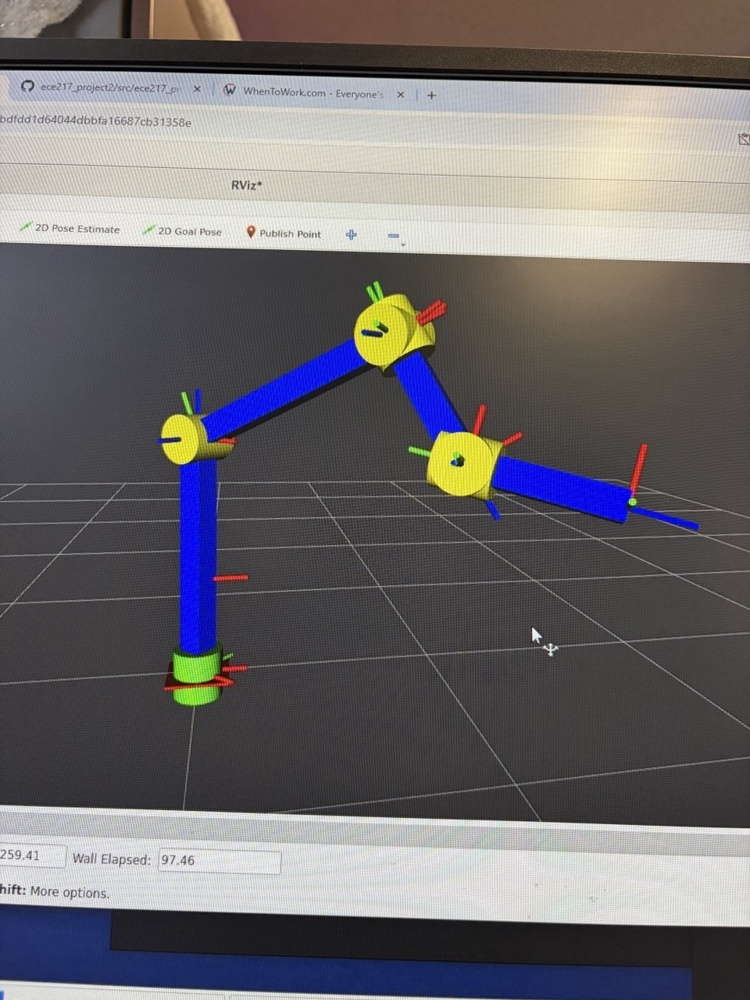

 <!-- Single Image with Caption (Best for System Diagrams or Bench Setups)-->
<figure class="my-6">
  
  <figcaption class="mt-2 text-xs text-zinc-500 text-center">
    Factory Acceptance Testing (FAT) station with high-precision DMM and SMU load fixtures.
  </figcaption>
</figure>

<!-- Side-by-Side Comparison Grid (Best for KiCad Layout vs. Physical PCB)-->

          <figure>
            
            <figcaption class="mt-1.5 text-xs text-zinc-500 text-center">
              Base station with a Heltec ESP32-S3R2 board and an external LoRa antenna.
            </figcaption>
          </figure>

          <figure>
            
            <figcaption class="mt-1.5 text-xs text-zinc-500 text-center">
              Mobile tracker with a Quectel L76K GNSS module and a LiPo battery.
            </figcaption>
          </figure>

<!-- Side by side with one common caption-->

<figure class="my-6">
          
        </figure>

        <figure class="my-6">
          
          <figcaption class="mt-2 text-xs text-zinc-500 text-center">
            Six-axis arm model used to visualize joint motion in RViz2.
          </figcaption>
</figure>

<!-- Auto-Playing Loop Video (Best for RViz2 & Gazebo Simulations)-->
<figure class="my-6">
  <video 
    autoplay 
    loop 
    muted 
    playsinline 
    class="w-full rounded-lg border border-zinc-200 bg-zinc-900"
  >
    <source src="assets/rviz-lattice.mp4" type="video/mp4" />
    Your browser does not support the video tag.
  </video>
  <figcaption class="mt-2 text-xs text-zinc-500 text-center">
    Real-time A* state-lattice expansion and 64-bit bitmask collision checking in RViz2.
  </figcaption>
</figure>

<!-- Optional: Add Thumbnail Previews to the Home Page Cards-->

